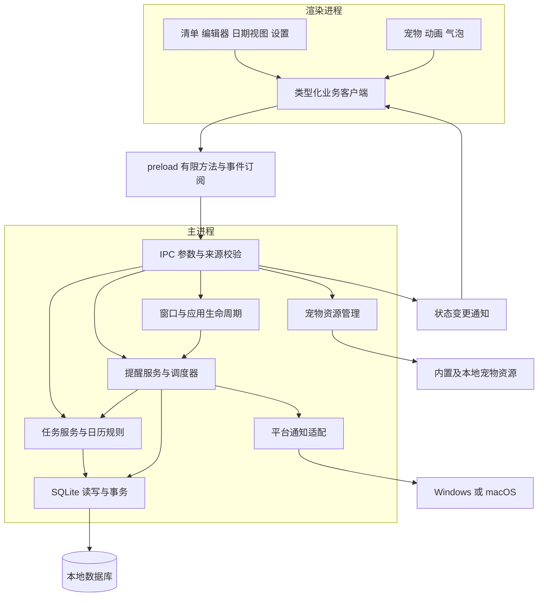
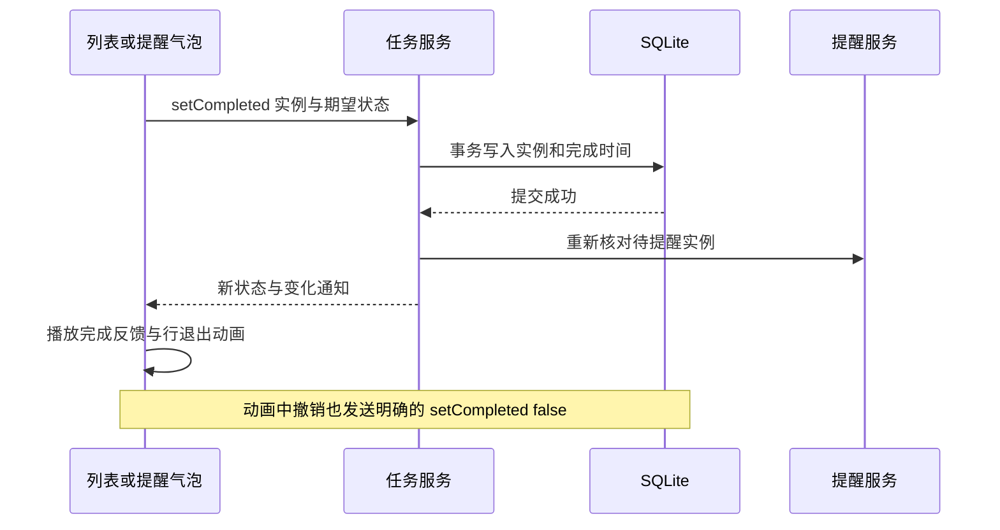

# 桌面任务助手应用架构

版本：0.3。更新日期：2026-11-03。状态：M1 数据与任务服务、M2 任务编辑/计划管理/日期历史界面已接通。验证范围见 [M1](m1-verification.md)、[M2 验证记录](m2-verification.md)，原生平台缺口仍见 [M0 验证记录](m0-verification.md)。

采用 **Electron + React + TypeScript + SQLite**，以当前优化后的 [HTML 原型](dual-platform-prototype.html) 为界面与交互基线。任务和提醒在 Electron 主进程中运行，React 负责界面与宠物表现，SQLite 是持久业务数据的唯一来源。一个主要透明窗口承载宠物与任务卡片。

本文明确代码组织、规则所有权、跨进程接口、提醒与窗口生命周期。数据库细节见 [数据模型](data-model.md)，产品范围见 [需求文档](requirements.md)，技术比较见 [技术选型](technical-selection.md)。HTML 中的示例数组、模拟时钟、通知 DOM 和事件日志不迁入正式业务实现。

## 1 本轮架构决定

| 主题 | 决定 | 目的 |
| --- | --- | --- |
| 工程 | 一个桌面项目，electron-vite 构建，electron-builder 打包 | 保持双平台共用代码，按平台隔离少量系统差异 |
| 进程 | 主进程管理业务；preload 提供窄接口；React 渲染界面 | 隐藏或重建界面不会停止任务与提醒 |
| 存储 | SQLite，主进程单连接、小事务；候选驱动 better-sqlite3 | 保存与调度使用同一份任务事实 |
| 任务 | 一次性任务直接保存为实例；重复计划按日期和时间槽产生实例 | 避免为一次性任务维护两份相同记录 |
| 历史 | 保存实例快照，计划只维护当前规则及版本号 | 保护历史，满足首版不补造未运行日期的边界 |
| 状态 | React 本地状态承载草稿与视图；主进程承载任务、提醒和窗口事实 | 界面切换不改变业务结果 |
| 窗口 | 一个主要窗口，完整清单、仅桌宠、后台隐藏三种模式 | 统一位置与生命周期，减少窗口同步逻辑 |
| 提醒 | 主进程调度，提交状态持久化；可见气泡与系统通知分别处理 | 防止普通宠物互动覆盖待处理提醒 |
| 宠物 | 小型表现控制器，消费业务结果；通过资源描述播放动作 | 动画异常不会影响任务保存 |
| 资源库 | 覆盖原型中的选择、参数和本地资源导入，独立于任务模块分批实现 | 先跑通一套角色与任务闭环，再补齐资源管理 |
| 部署 | 本地应用与本地数据库，直接分发安装包 | 与当前单机使用范围一致 |

正式依赖版本在 M0 锁定受支持稳定版本与锁文件。首轮候选测试范围为 Windows x64 与 Mac Apple Silicon；原型中的 Windows 10/11、macOS 13+ 和 Intel 包属于需用所选依赖实际验证的兼容目标。

## 2 总体结构与规则所有权



| 规则或状态 | 唯一负责人 | 其他模块如何使用 |
| --- | --- | --- |
| 日期归属、计划生效、实例生成与去重 | tasks | 界面与调度器使用同一服务结果 |
| 完成、撤销、删除、移动与进度统计 | tasks | 通知按钮、气泡和列表走相同命令 |
| 提醒资格、处理记录、恢复与待处理提醒 | reminders | 界面只呈现和发出明确操作 |
| 系统通知提交与点击回调 | desktop/notifications | 返回提交或失败结果，不修改完成状态 |
| 完整、仅桌宠、隐藏、退出与位置 | desktop/window | React 读取状态并请求切换，不直接维护第二个隐藏开关 |
| 当前时刻、本地日期、时区解析 | domain/time | 每个业务命令使用一个时钟快照 |
| 动画优先级和播放 | renderer/pet | 消费提醒状态和成功的任务结果 |
| 素材发现、路径解析与导入 | pets | 任务模块只保存可选场景标识，不依赖具体文件 |

Electron 自身的主进程、渲染进程与 preload 分工参考 [进程模型](https://www.electronjs.org/docs/latest/tutorial/process-model) 和 [IPC 文档](https://www.electronjs.org/docs/latest/tutorial/ipc)。这里的业务模块由普通函数和少量对象组成，初始化时显式传入数据库、时钟和平台适配，不建设通用依赖注入或事件总线框架。

提醒调度依赖任务查询，不反向控制任务写入。任务事务需要确认提醒时，调用提醒记录层的同步写入函数；事务提交后由入口协调重新安排调度。这样保留原子性，同时避免任务服务与提醒调度服务互相调用形成循环。

## 3 建议目录

以下为目标目录。M1 已建立 database/connection、database/migrations、domain、tasks、settings/repository 和 reminders/repository；M2 已建立 renderer/src/features 下的 tasks、editor、plans、calendar。当前已补充 features/pet，接入 V3、香香猫、臭臭汪与猪猪四套内置精灵图、持久化角色选择、动作优先级与预览；用户素材导入仍属于后续批次。设置由独立 repository 校验并持久化；任务服务负责业务事务，查询层保持只读。

```text
src/
  main/
    index.ts                   # 单实例、启动顺序、依赖组装与退出
    ipc.ts                     # 注册有限 IPC，校验来源与参数
    database/
      connection.ts
      migrations/
    domain/
      time.ts                  # 日期、时区与下班时间计算
      recurrence.ts            # 实例候选与计划生效计算，纯函数
    tasks/
      service.ts               # 写操作、事务边界、今日协调
      queries.ts               # 日期视图、历史与进度
      repository.ts            # 本模块 SQL
    settings/
      repository.ts            # 类型化设置、版本检查与宿主偏好保存
    reminders/
      service.ts               # 待处理提醒与确认，维护调度唤醒
      repository.ts            # 到期查询与提交记录
    desktop/
      window.ts                # 模式、原生边界、拖动与焦点
      tray.ts                  # Windows 托盘或 macOS 菜单栏
      notifications.ts         # 原生通知提交、关闭与点击
      lifecycle.ts             # 休眠、恢复、显示器与日期检查
    pets/
      catalog.ts               # 内置和本地资源包
      assets.ts                # 资源协议与受限路径解析
      import.ts                # 资源管理批次接入
  preload/
    index.ts                   # contextBridge 与订阅清理
  shared/
    contracts.ts               # IPC 请求、结果、视图和事件类型
    pet-manifest.ts            # 资源描述与校验规则
  renderer/
    App.tsx
    api/desktop.ts             # 业务接口，不携带 Electron 或 SQL
    features/
      tasks/
      editor/
      calendar/
      plans/
      pet/                     # 播放器、气泡优先级与点击拖动手势
      settings/
      pet-library/
    styles/
resources/
  pets/<pet-id>/manifest.json
tests/
  domain/
  integration/
docs/
```

`shared` 不依赖 Electron、数据库或 React；纯规则只接收参数。只有平台适配文件处理 `process.platform`，避免任务规则中散落平台分支。界面先使用 React 自带状态能力；无实际需要时不引入全局状态框架。

## 4 跨进程接口

### 4.1 命令与查询

渲染进程通过 `window.desktop` 调用具名方法。preload 内部使用 `invoke/handle`，不暴露通用 `send(channel, payload)`、任意 SQL 或任意文件路径操作。

| 分组 | 方法 | 语义 |
| --- | --- | --- |
| app | `bootstrap()` | 获取今日摘要、设置、窗口与当前提醒，附带会话和数据修订号 |
| tasks | `getDay(date)`、`getHistoryDates(range)` | 只读，返回已保存记录和明确标记的未来计划预览 |
| tasks | `createOnce(input)`、`updateOnce(input)` | 新增或编辑一次性任务 |
| tasks | `setCompleted(ref, completed)` | 设置期望完成状态，不提供反转状态的 toggle 命令 |
| tasks | `removeOccurrence(ref)`、`moveToToday(ref)` | 仅操作本次实例，幂等处理重复请求 |
| plans | `list()`、`create(input)`、`update(input)` | 日/周/月周期及时间槽配置 |
| plans | `setPaused(id, paused)`、`end(id)` | 改变后续安排，保留已有发生记录 |
| reminders | `acknowledge(ids)`、`locate(ids)` | 结束气泡呈现或定位，均不代表完成任务 |
| settings | `update(patch)` | 只接受定义好的设置字段 |
| window | `setMode(mode)`、`requestClose()`、`quit()` | 模式变化、关闭选择与明确退出 |
| window | `beginDrag()`、`endDrag()` | 宿主读取屏幕坐标并更新窗口，页面不传任意系统坐标 |
| pets | `list()`、`select(id)`、`updateDisplay(input)` | 资源选择与显示参数 |
| pets | `importFromDialog()`、`openUserDirectory()` | 主进程选择文件和打开固定目录，资源管理批次接入 |
| events | `subscribe(listener)` | 订阅变化并返回取消订阅函数 |

创建命令携带一次生成的 `requestId`，数据库对创建键做唯一约束。请求超时重试沿用同一创建键，避免生成重复任务。编辑携带 `expectedVersion`，旧编辑器覆盖新修改时返回冲突；完成、暂停等操作使用明确的期望状态实现幂等。

```typescript
type OccurrenceRef =
  | { id: string }
  | { planId: string; sourceDate: string; slotId: string; expectedPlanVersion: number };

type AppResult<T> =
  | { ok: true; value: T; sessionId: string; revision: number }
  | { ok: false; error: {
      code: 'VALIDATION' | 'NOT_FOUND' | 'CONFLICT' | 'STORAGE' | 'UNAVAILABLE';
      message: string;
      field?: string;
    }};

type AppEvent = {
  sessionId: string;
  revision: number;
  kind: 'data-changed' | 'reminders-changed' | 'window-changed' | 'clock-changed';
};
```

`OccurrenceRef` 的第二种形式用于未来日期的计划预览；只有用户发出写命令时才解析为实例。日期、时间、标题长度、标识和资源描述都在主进程校验，TypeScript 类型不能替代运行时校验。

### 4.2 界面同步

- 界面先订阅，再读取快照；每次变化携带主进程会话 ID 和递增修订号。
- 首版事件用于通知“需要重新读取”，不维护另一套需要逐字段回放的任务副本。
- 日期视图按日期区分请求；旧请求返回后不能覆盖用户刚切换的新日期。相同日期按修订号拒绝旧结果。
- 重新显示、页面重建或重连时重新读取快照，漏掉一个事件不丢失业务事实。
- 菜单栏与仅桌宠胶囊展示今日摘要；查看昨天或明天不会把系统入口中的今日进度改成所选日期进度。
- 数据保存失败保留编辑草稿，并给出重试入口；失败结果不触发完成庆祝。

## 5 任务与历史边界

完整字段和约束见 [数据模型](data-model.md)。核心关系为“一个重复计划 → 多个稳定时间槽 → 每天每槽至多一个实例”；一次性任务直接是一条实例。

### 5.1 生成与查询分离

- 启动、跨天、计划写操作前后调用 `ensureToday`，在事务中补齐今天并记录当天已激活。
- `getDay` 和组件渲染只读数据，不在查询函数中生成、修改或删除任务。
- 未来日期由当前计划计算预览，覆盖已经保存的本次例外；单纯查看不会提前落库或制造历史。
- 用户操作一个预览实例时，在明确写命令的同一事务中解析并落库，再执行完成、删除等操作；过期计划版本返回冲突。
- 过去日期只显示已有记录，不用当前规则倒推过去。应用未运行且没有记录的日期显示“没有生成记录”，不显示成已完成或全部逾期。
- 日期选择使用同窗口的模态浮层，选择后关闭；说明用途、标记有历史记录的日期，关闭时恢复焦点。日期和进度共用一行，避免固定高度卡片被导航挤压。未来快捷新增把所选日期传给原有任务服务，保留当前视图；历史视图只保留已有任务操作和移到今天的提示。

请求入口与原生生命周期共用日界线协调：处理请求前若发现本地日期已变，先协调新的一天，再进入只读查询或业务命令，避免低频校验尚未触发时读取到空的今日清单。

### 5.2 编辑、暂停和迁移

- 编辑、暂停或结束计划前先补齐今天，保存已经到点的事实。后续处理只影响尚未到点、未完成且未手动迁移的安排。
- 时间槽有稳定 ID。将 10:00 改为 15:00，属于同一个槽的调整；删除一个槽再新增另一个槽，属于新安排。
- 某槽今天已经到点或完成，改时间后今天不再额外生成第二次；次日起按新时间执行。新增加的已过时间从后续日期生效。
- 初次创建、开始日期为今天的计划可以包含今天已过时间，作为当日待办汇总；编辑或恢复不补发暂停期间的事项。
- 删除本次保留取消标记，生成时检查所有状态，不能因有效列表中找不到它就重新生成。
- “移到今天”更新同一实例的执行日期，保留来源日期、槽和实例 ID；原日期不会重新补出副本。默认移为今天无时间待办，需要再次设置时间时另行明确操作。
- 原型中示意性的“清理今日全部未完成实例”不作为历史删除规则；结束计划保留已到点未完成和全部已完成记录。

### 5.3 完成与动画



正式实现先保存业务结果，再播放原型中的打勾、删除线和庆祝。原型的约 880ms 动画不成为业务提交延迟；动画期间再次点击发送撤销命令。渲染失败、切页或动画中断不会丢失完成状态。

渲染层 `use-task-completion` 只保存正在退出的任务行及其动画阶段，主进程快照仍是完成状态和统计的唯一来源。成功保存后保留 620ms 的撤销窗口，再用 260ms 折叠任务行；撤销失败会保留已完成反馈并显示命令错误，完成失败则恢复原任务行。该控制器由 App 持有，切换标签、日期或仅桌宠模式不会取消已提交的业务操作。未来预览落库后按来源日期、计划与时间槽匹配原行，避免新 ID 产生重复行。系统减少动态效果时直接提交并刷新，无等待动画。

全部完成只由本次成功完成命令引起的“非空、未全部完成 → 全部完成”变化触发。启动恢复、删空列表和历史查看不触发今日庆祝。

## 6 提醒架构

### 6.1 唤醒与时间基准

提醒服务只维护一个最近唤醒定时器，下次唤醒取最近到期、下一个本地日界线、低频校验时间三者中最早者。首版校验间隔建议 30 秒；计划变化、完成操作和休眠恢复立即重新安排。查询使用到期索引，无需每秒遍历所有任务或为每项任务创建常驻定时器。

每次处理捕获同一个 `{ nowMs, today, timeZone }` 时钟快照，重新检查实例是否仍有效。业务时间使用真实系统时钟；可测试的日期函数接收时钟参数。界面显示每秒刷新，隐藏时停止刷新，恢复时重新计算，不维护递减秒数。

时区解析统一放在 `domain/time.ts`，建议封装 `@js-temporal/polyfill` 的日期与时区转换，显示使用 `Intl`。日界线按本地日历计算，不使用固定 86400000 毫秒加一天。夏令时重复时间取第一次，缺失时间按跳变间隔顺延，并始终按日期与槽去重。[Temporal 时区语义](https://tc39.es/proposal-temporal/docs/timezone.html)、[polyfill 项目](https://github.com/js-temporal/temporal-polyfill)

系统时区改变后，仅重算尚未到点、未完成安排的解析时间；已发生记录保留原时区与时间。来源日期与槽的唯一键不随 UTC 偏移变化。若本地日期也改变，先协调当前日再更新界面。

### 6.2 系统提交与气泡分别管理

1. 查询今天有效、到点、未完成、开启提醒且当前提醒版本尚未处理的实例。
2. 在短事务内领取本批提醒，保存稳定的提醒 ID 和批次 ID。
3. 退出事务后重新校验资格，提交一个系统通知；同时向界面提供待处理提醒快照。
4. 保存通知提交、失败或不可用结果，重新安排下一次唤醒。
5. 通知点击统一解析实例 ID，显示窗口并定位。多项通知进入到点列表，不强制把多项都标为完成。

普通重启读取提交记录防止重复提交。数据库和系统通知无法原子提交：启动发现领取后没有结果的记录时标为结果不明，恢复到气泡或汇总区，不无限重发。不宣称严格恰好一次投递。

系统通知被关闭不代表任务完成，也不能依赖系统的关闭事件确认用户处理。气泡“知道了/查看”只结束该次气泡呈现；“完成了”使用任务服务的同一个完成命令。撤销完成不自动重置提醒记录。真正改到另一个未来时间才增加提醒版本。

窗口隐藏时仍提交通知，不自动弹出窗口。重新显示可重建当天尚未确认的气泡；明确退出后不再产生通知。启动或恢复只汇总当日遗漏，不重放旧日期通知。通知不可用时记录失败状态并保留应用内提醒，不能显示“已经送达”。

后台网页定时器会节流，因此提醒独立于渲染进程；恢复处理使用原生电源事件并辅以低频时间校验。[后台节流](https://www.electronjs.org/docs/latest/api/web-contents#contentsbackgroundthrottling)、[电源事件](https://www.electronjs.org/docs/latest/api/power-monitor)

## 7 窗口与应用生命周期

将两个状态分开：`displayMode = expanded | compact` 表示内容布局，`visibility = visible | hidden` 表示原生窗口是否显示。退出是应用生命周期，不再塞入可恢复的隐藏状态。

| 事件 | 主进程行为 |
| --- | --- |
| 点击收起、双击宠物 | 切换 compact，保留宠物、气泡与今日摘要 |
| 展开或从气泡定位 | 切换 expanded；定位时同步切换日期与任务 |
| 点击组件关闭 | 请求原生三选一对话框：隐藏、退出、取消；多个关闭请求合并 |
| 隐藏 | `hide()`，保存最后布局，继续任务服务；暂停动画 |
| 托盘显示、macOS 激活或重复启动 | 恢复窗口与保存的布局，重新读取数据 |
| 托盘退出、系统退出或 macOS ⌘Q | 设置退出意图，停止调度，结束必要写入并关闭资源，不再次弹组件关闭框 |
| 渲染进程失效 | 任务与提醒继续；重建界面后读取完整快照 |
| 外接屏断开或工作区变化 | 将窗口边界限制到可见工作区，保留合理宠物锚点 |

启动顺序为单实例检查 → 打开数据库并迁移 → 注册资源与 IPC → 协调今日 → 创建后台入口与窗口 → 启动提醒。迁移失败时保持原数据并显示恢复入口，不创建空库伪装成功。

窗口展开标准尺寸为 356 × 480 逻辑像素，大号预设为 440 × 610；上次展开尺寸持久化到设置；仅桌宠时根据宠物、摘要和气泡包围框缩小原生窗口。提醒气泡变高、打开编辑器或资源库时，先切换到可容纳内容的布局，再显示内容。收起动画结束再缩小边界，展开则先扩大边界再播放动画，避免裁剪。

当前清单卡片常驻并通过裁剪、透明度和位移完成 340ms 过渡；收起后用 `inert` 排除键盘和指针交互，微缩胶囊淡入。主进程收起时延后缩至 356 × 224，反向展开会取消尚未执行的缩窗计时器；退出同样清理计时器。

主进程负责窗口位置与逻辑坐标，宠物拖动超过手势阈值才开始原生位置更新，结束后保存。双击优先于普通点击反馈；按钮、输入框和任务行排除拖动。窗口置顶默认沿用原型，并可在设置中关闭。

透明窗的自动鼠标穿透与缩放存在平台限制。`resizable: false` 只作为用户不可拖拽缩放的配置；程序切换边界能否在目标环境稳定工作必须在 M0 验证，不能只根据普通窗口的 `setBounds` API 推断。M0 同时检查透明边缘、焦点、输入和缩小后的遮挡；未通过时先调整宿主方案，再固定单窗口实现。[透明窗口限制](https://www.electronjs.org/docs/latest/tutorial/custom-window-styles)、[窗口边界 API](https://www.electronjs.org/docs/latest/api/base-window#winsetboundsbounds-animate)

## 8 宠物表现与资源

### 8.1 优先级

| 优先级 | 来源 | 处理 |
| --- | --- | --- |
| 最高 | 未处理的到点提醒 | 保留任务引用、台词与操作按钮，普通点击和庆祝不能覆盖 |
| 中 | 全部完成、单项完成或点击回应 | 限时播放，重复点击合并；有提醒时不积压普通动作 |
| 最低 | 待机与下班倒计时 | 没有上层状态时显示 |

主进程保留待处理提醒身份和确认状态；渲染进程的控制器只决定如何显示，不能用一个任意 `setPetState` 同时清掉业务提醒。动画结束或界面重建后重新依据当前提醒状态决定表现。关闭一个气泡不改变任务状态。

### 8.2 素材格式与资源管理

资源描述区分 `sprite-sheet` 和 `animated-image`。精灵图声明每帧宽高、行列、帧数、帧率、循环与锚点；GIF 或动态 WebP 按文件自身的帧率和循环显示，不能把精灵图的 FPS 滑块承诺为通用动图调速。需要精确动作次数和节能控制时优先使用精灵图。

草莓兔 V3.1.0 的鼓掌、欢呼、喝水已按待机原图重绘，并以单一等比尺度烘焙到 PNG/APNG，不再声明 `proportions`；鼓掌与欢呼的首尾复用待机原帧。其余动作仍可声明 `proportions` 显示校准：头部区域等比缩放，颈部以下补偿纵向长度。`pet-proportions.ts` 计算连续的上下两段绘制区域，未声明校准的动作整帧原样绘制。播放器沿用原有帧时钟，资源预览使用相同规则。

状态沿用 `idle`、`react`、`celebrate`、`all_done`、`remind`；可选喝水、运动等场景动作。未指定场景的任务使用通用提醒，不仅凭标题包含某个字就决定动作。缺失可选动作回退为通用动作，`idle` 不可用时回退内置角色。

当前内置包为 `resources/pets/strawberry-bunny-v3`、`resources/pets/xiang-xiang-mao`、`resources/pets/chou-chou-wang` 和 `resources/pets/zhu-zhu`。`pet-pack.ts` 静态登记四套包，仅引用各自七张精灵图与 manifest，由现有 `buddy-app://ui` 协议提供；预览页面、APNG、旧版本和生成资料不随应用打包。`settings.petId` 是所选角色的唯一来源，设置更新入口只接受已登记的内置 ID，并沿用版本校验和 SQLite 事务；保存失败不改变选择。保留历史未知资源 ID，显示时回退到默认内置包，不重置其他设置。Canvas 依据所选 manifest 的 320 × 320 帧尺寸、列数、帧数与帧率播放；切换角色会取消旧图像加载和时钟，父界面的时钟刷新不重置动作。隐藏与系统暂停只停止动画时钟，恢复时不累计隐藏期间的时间；系统减少动态效果偏好显示静态帧。

点击与任务成功结果产生单次回应，播放完回到待机或当前动作预览；回应与完成台词来自所选包的 manifest。待处理提醒根据实例的 `scene` 选择摇铃、喝水或拉伸，压过普通互动并丢弃被打断的普通动作；切换角色不确认或清除提醒。编辑器允许明确选择提醒动作，顶栏动作面板提供角色选择和七组循环预览。旧 `builtin-cat` 是占位内置角色的别名，设置读取时仍对应 V3，后续正常设置写入持久化新 ID，不重置其他偏好。

内置资源目录只读，用户导入复制到用户数据目录，显示参数覆盖值单独保存在设置中。界面接收资源 ID 和 `pet-asset://` URL，不接收任意磁盘路径。主进程注册资源协议，只允许解析已登记包内的文件，并保留内容安全策略。[Electron 自定义协议](https://www.electronjs.org/docs/latest/api/protocol)

导入通过系统选择框读取 zip 或文件夹，在临时目录完成校验后整体移动到资源目录。校验包格式版本、资源存在性、尺寸与帧数、相对路径、符号链接和解压大小；导入只接受 JSON 与 PNG、WebP、GIF，资源包不能执行脚本。失败不覆盖已安装包。首版用保守上限，具体大小在素材样本验证后确定。

资源选择和配置可以在主闭环后实现，导入单列一个工作包；无需改动任务数据库或提醒算法。此批次覆盖原型扩展能力，工期不自动并入之前仅含一套素材的估算。

## 9 故障边界与本地数据

| 故障 | 结果与恢复 |
| --- | --- |
| 任务保存失败 | 事务回滚，界面保留草稿；不播放成功反馈 |
| 通知失败或权限不可用 | 保存提交结果、保留应用内提醒，任务继续可操作 |
| 动画或宠物资源失败 | 回退内置或静态表现，任务服务继续运行 |
| 渲染页面崩溃 | 主进程保持调度，重建页面并读取快照 |
| 主进程异常退出 | 已提交数据由 SQLite 恢复；下次启动做当日协调与提醒恢复 |
| 迁移失败 | 保留原库及迁移前备份，展示错误，不静默重置 |

数据位置使用应用用户目录，正式版和开发版使用不同应用标识以隔离数据。计划、任务和设置在正常操作时保存；拖动坐标在释放时保存，不依赖退出钩子兜底所有数据。

页面只加载打包的界面与本地素材，替换原型中的 CDN 样式脚本。任务标题和资源台词以纯文本渲染。启用 `contextIsolation`、渲染沙箱并关闭 Node 集成；IPC 校验来源窗口与主框架；不向页面提供通用 shell 或文件系统入口。[Electron 安全建议](https://www.electronjs.org/docs/latest/tutorial/security)

## 10 编码顺序与验收依据

| 顺序 | 先完成什么 | 能检验什么 |
| --- | --- | --- |
| 1 | 原生窗口、模式切换、后台入口、安装后通知和 SQLite 样本 | Electron 宿主方案、签名条件与原生模块组合可用 |
| 2 | 数据迁移、时间规则、任务服务与接口 | 日期、去重、历史保护和失败回滚 |
| 3 | React 清单、编辑器、日期视图与进度 | 以真实业务数据复现原型主流程 |
| 4 | 主进程提醒、领取与结果记录、气泡恢复 | 隐藏与休眠后仍能正确处理提醒 |
| 5 | 一套精灵图、优先级、仅桌宠与下班倒计时 | 完成与提醒不会被动画状态破坏 |
| 6 | 宠物选择、显示参数与导入 | 补齐原型的资源管理能力 |
| 7 | 双平台安装、升级、多屏、异常退出和性能回归 | 满足完整交付而非仅页面展示 |

任务规则通过可控时钟与临时数据库测试；窗口、原生通知、签名、多屏和休眠使用安装包真机验收。尤其覆盖删除后不复活、迁移后不补副本、编辑后不改写历史、动画中撤销、重复命令、时区变化，以及通知领取前后崩溃恢复。

Windows 通知身份、macOS 通知签名和旧通知点击能力按锁定版本验证。首版必须验证运行中及后台隐藏时的点击定位；退出后没有驻留调度器，旧通知如触发系统冷启动则进入正常启动流程并校验任务是否仍有效。[通知平台差异](https://www.electronjs.org/docs/latest/tutorial/notifications)、[通知 API](https://www.electronjs.org/docs/latest/api/notification)

架构设计完成后可按上述顺序建立应用。当前文档确定职责和规则，不把原型读取、接口草案或官方 API 能力说明当作双平台实现验收结果。


## v0.3 调度与偏好接入

- `domain/recurrence.ts` 在统一候选入口匹配日/周/月规则，供今日协调、未来预览和实例落库共用。`tasks.setPriority` 只修改本次优先级，计划规则与提醒安排版本不变。
- `SettingsService` 负责 UI/系统菜单偏好写入：先校验并更新事务内设置，再应用系统登录项与窗口副作用。系统拒绝或窗口失败时回滚数据库，并尝试恢复已改变的原生状态；错误可见。
- `SystemLoginItems` 只在安装版注册登录项，检查 macOS 服务状态或 Windows 启动项生效状态；启动时读取系统设置，尊重用户在系统中做的调整。
- 透明窗口保持 `resizable:false`，由右下角指针手势启动主进程 cursor/bounds 调整，释放后保存尺寸；避免依赖透明窗不可靠的原生边框缩放。尺寸约束为 356×480 至 520×780，并适配可用显示区域。
- 主进程领取一批提醒后按声音偏好发送一次 `reminders:play-sound`，renderer 用 Web Audio 播放原型音色；系统通知设置 `silent:true` 防止重复音效或绕过静音。该信号不控制任务或通知持久状态，主动试听不受静音开关限制。
- 设置使用覆盖式原生 `<dialog>`，保留任务列表和输入位置；失败保留设置入口并说明原因。标准尺寸下内容可滚动，不扩大原生窗口来显示长编辑器。
