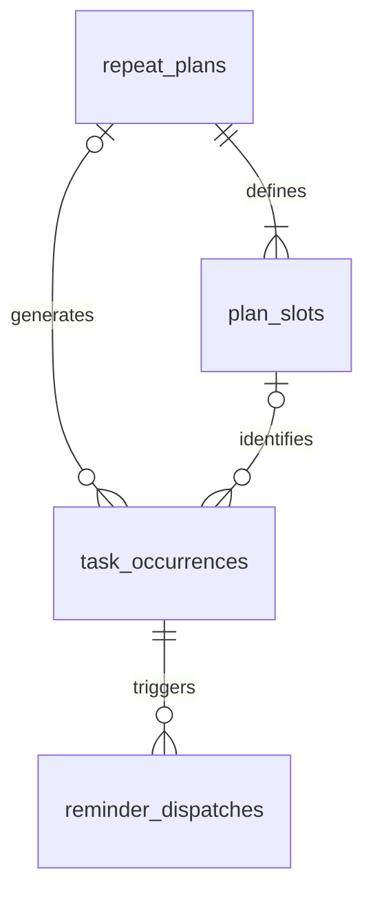

# 桌面任务助手数据模型

版本：0.2。更新日期：2026-11-02。对应 [应用架构](architecture.md)。六张核心表及下述任务事务已在 M1 落实，SQLite `user_version=2`；验证证据与界面边界见 [M1 验证记录](m1-verification.md)。

首版保存当前重复规则和真实产生的任务实例。一次性任务只占一条实例，重复任务保留独立计划及稳定时间槽。完成状态、历史展示和提醒资格全部从同一份实例记录取得。

## 1 关系与简化决定



核心为六张表：`repeat_plans`、`plan_slots`、`task_occurrences`、`reminder_dispatches`、`calendar_days`、`app_settings`。迁移版本单独由 SQLite `user_version` 或迁移工具管理。

相较技术选型阶段的概念草案，首版不为一次性任务再建一张模板记录，也不引入完整 `schedule_revisions` 表。原因是历史由实例快照保存，而未生成的过去日期不会按现行规则补造。计划的整数版本用于并发编辑与来源标记，不承诺恢复任意历史计划版本；若后续增加审计或历史规则回放，再增加不可变规则版本表。

通用约定：

- 标识使用随机 UUID，不使用毫秒时间作为唯一 ID。
- 本地日期使用 `YYYY-MM-DD`，时间使用 `HH:mm`，时区使用 IANA 标识。
- `*_at_ms`、`due_at_ms`、`effective_from_ms` 使用 UTC epoch 毫秒整数，不能与秒混用。
- `version` 在实体变化后递增；写事务中校验 `expectedVersion`。
- 正常查询过滤取消记录，生成和去重必须检查所有状态。
- 标题去空白后为 1 至 60 个 Unicode 字符；日期有效性与时间格式由主进程统一校验。

## 2 表定义

### 2.1 repeat_plans 每日重复计划

| 字段 | 含义 |
| --- | --- |
| `id` | 计划主键 |
| `creation_key` | 创建请求唯一键，用于超时重试去重 |
| `title` | 当前计划名称 |
| `state` | `active`、`paused`、`ended` |
| `start_date`、`end_date` | 日历日期范围，结束日期可空且包含当天 |
| `reminder_enabled` | 新生成或尚未到点实例的提醒偏好 |
| `scene` | 可选 `generic`、`water`、`stretch` 等表现标识，默认通用 |
| `effective_from_ms` | 现行规则允许生成新安排的最早时刻 |
| `version` | 当前规则及状态版本 |
| `created_at_ms`、`updated_at_ms` | 创建与修改时间 |

首次创建且开始日期为今天时，允许生成今天已经到点的安排，因此初始生效下界可取今天本地日界线。编辑或恢复时将下界设为操作时刻；已有到点实例不受新下界影响。未来日期还需同时满足 `start_date` 和 `end_date`。

### 2.2 plan_slots 稳定时间槽

| 字段 | 含义 |
| --- | --- |
| `id` | 时间槽主键，修改时间不改变 ID |
| `plan_id` | 所属计划外键 |
| `local_time` | 每日执行时间 |
| `active` | 是否仍属于当前计划，移除后保留记录 |
| `sort_order` | 界面稳定排序，展示时仍按时间排序 |

同一计划的有效时间槽不得同一时间重复。移除用停用标记，不删除被历史实例引用的槽。删除后重新添加一个时间创建新槽 ID；只修改现有时间则沿用原 ID。

### 2.3 task_occurrences 实际执行记录

| 字段 | 含义 |
| --- | --- |
| `id` | 实例主键，移动日期时不变 |
| `creation_key` | 一次性创建的唯一请求键；重复生成时可空 |
| `plan_id`、`slot_id` | 一次性任务都为空，重复实例都非空 |
| `plan_version` | 最近一次生成或调整时的来源版本；历史快照不依赖计划当前值 |
| `source_date`、`source_time`、`source_zone` | 首次生成的计划日期、时间与时区，作为来源信息保留 |
| `scheduled_date`、`scheduled_time` | 当前执行日期与时间，时间可空 |
| `schedule_zone`、`due_at_ms` | 当前执行时间的时区与 UTC 解析值；无时间时到期值为空 |
| `title`、`scene` | 实例内容快照，不动态联表覆盖历史 |
| `status` | `pending`、`completed`、`cancelled` |
| `cancel_reason` | 本次删除、计划暂停、计划变更或计划结束；未取消时为空 |
| `manual_override` | 是否经过手动迁移，防止被计划协调器覆盖 |
| `reminder_enabled` | 本次提醒开关快照 |
| `schedule_version` | 当前提醒安排版本，仅在实际重新安排时间等情况下增加 |
| `completed_at_ms` | 当前有效完成时间，撤销后清空 |
| `version`、`created_at_ms`、`updated_at_ms` | 并发检查和记录时间 |

重复实例逻辑身份为 `(plan_id, source_date, slot_id)`，与执行日期、是否完成、是否取消无关。这个身份解决三类问题：删除本次后不复活；移到今天后原日期不补副本；同槽改时间后不产生两条同日任务。

完成记录首版直接保存在实例中，不另外维护一张可与任务状态失配的完成表。撤销表示当前完成记录失效，不提供多次完成与撤销的审计流水。

### 2.4 reminder_dispatches 提醒处理记录

| 字段 | 含义 |
| --- | --- |
| `id` | 稳定提醒 ID，供原生通知定位 |
| `occurrence_id`、`schedule_version` | 对应实例和当时的安排版本 |
| `batch_id` | 同时到点或恢复汇总的通知批次标识 |
| `state` | `claimed`、`submitted`、`failed`、`unavailable`、`uncertain` |
| `claimed_at_ms`、`submitted_at_ms` | 领取与提交时间，尚未提交时后者为空 |
| `acknowledged_at_ms` | 用户已结束本次应用内提示的时间，不代表完成任务 |
| `error_code`、`error_message` | 提交失败或不可用原因，避免保存完整任务正文到诊断日志 |

一条记录表示一个逻辑提醒的处理结果，不表示操作系统或用户已经收到。单个原生通知可关联多条记录，用 `batch_id` 定位到点列表。

没有当前版本处理记录的到期实例才进入普通自动提交。已失败或不可用记录保留应用内提示，不每次校验都重试；将来增加重试入口时也沿用同一提醒 ID，并明确有限重试策略。领取中异常退出的记录恢复为 `uncertain`，转入应用内恢复提示。

任务完成、取消或手动移走时，在同一业务事务中确认相关应用内提示。撤销完成保留该确认记录，避免旧气泡立即复活。

### 2.5 calendar_days 已激活日期

| 字段 | 含义 |
| --- | --- |
| `local_date` | 主键，当时的本地日期 |
| `zone_at_activation` | 首次激活当天时的时区 |
| `activated_at_ms` | 应用实际运行并协调当天的时刻 |

这张小表区分“当天运行过，但没有安排”与“没有生成记录”。未来日期预览不插入此表；用户明确操作未来实例可以保存实例，但不伪造当天运行记录。系统时区或日期回拨后，重复激活同一日期不会复制任务。

### 2.6 app_settings 类型化偏好

单例记录保存固定下班时间、默认提醒开关、窗口置顶、上次完整或仅桌宠模式、窗口逻辑坐标、当前宠物 ID，以及按宠物 ID 保存的显示参数覆盖值。设置字段有明确类型和版本；不接受任意键名与文件路径写入。

隐藏状态与退出意图不持久化成下次必须隐藏启动的状态。首次启动显示完整界面，正常重新打开恢复最后的内容布局。

## 3 关键约束与索引

以下为迁移实现时需要落实的约束意图，字段类型以本页定义为准：

```sql
CREATE UNIQUE INDEX uq_active_slot_time
ON plan_slots(plan_id, local_time) WHERE active = 1;

CREATE UNIQUE INDEX uq_repeat_occurrence
ON task_occurrences(plan_id, source_date, slot_id)
WHERE plan_id IS NOT NULL;

CREATE UNIQUE INDEX uq_reminder_schedule
ON reminder_dispatches(occurrence_id, schedule_version);

CREATE INDEX ix_occurrence_day_status
ON task_occurrences(scheduled_date, status);

CREATE INDEX ix_occurrence_due
ON task_occurrences(due_at_ms)
WHERE status = 'pending' AND reminder_enabled = 1 AND due_at_ms IS NOT NULL;
```

此外，计划和一次性任务创建键各自有唯一约束；实例对计划、槽的关联必须一致，重复任务不能引用另一个计划的槽。数据库检查一次性与重复字段成组为空或非空，状态、取消原因与完成时间互相一致。开启外键检查并使用受限删除，不能级联删除全部历史。[SQLite 外键说明](https://www.sqlite.org/foreignkeys.html)

## 4 协调与写事务

### 4.1 ensureToday

1. 捕获当前时间、时区和本地日期。
2. 读取有效计划及槽，计算今天在日期范围和生效下界内的候选安排。
3. 按逻辑身份查询实例，找不到才插入；已完成、已到点、手动迁移和用户取消的实例保持原样。
4. 对因计划暂停或调整而取消的实例，只在当前规则重新有效且仍未到点时恢复或调整，沿用实例 ID。
5. 当天激活记录与实例更新一起提交。

它是显式写操作，由启动、跨天与相关命令调用，不放在 React 渲染或通用查询里。已到点判定同时保护旧实例；重算不能把已发生的事项从历史中擦掉。

### 4.2 更新、暂停或结束计划

在同一事务中先按旧规则协调今天，再检查计划版本、保存新规则并协调受影响的后续安排。仅处理尚未到点、未完成且没有手动迁移的实例。

暂停、结束或移除时间槽时使用带原因的取消记录；恢复时只考虑未来有效安排。用户删除本次的取消标记始终保留，不与计划暂停的临时取消混为一类。计划结束后保留记录，界面默认不列入活动计划。

### 4.3 完成与撤销

完成事务更新实例状态与完成时间，确认当前提醒，并返回本次操作前后该执行日期的统计。已经是目标状态时返回现状，不再写入第二次完成时间或重复庆祝。

撤销清空当前完成时间，但不清空已处理提醒记录。两条相反命令在主进程中按收到的顺序串行处理；界面也对同一实例串行提交，避免快速点击造成请求返回顺序反转。

### 4.4 删除与移到今天

- 删除：将实例置为 `cancelled/user_removed`，确认提示。统计只包括未取消实例；唯一约束仍阻止再次生成。
- 移动：保留实例 ID 和来源字段，将执行日期改为今天、时间与到期值清空，设置 `manual_override`，确认旧提示并增加安排版本。今日无时间待办不会立即重复通知。
- 同一移动请求重复执行直接返回已移动结果，不再次复制或修改来源信息。
- 如果以后要给迁移实例单独指定时间，应增加明确的本次编辑交互，不能通过编辑整个重复计划间接改变它。

### 4.5 更改实际提醒时间

未发生的一次性任务改日期或时间、未到点重复实例随计划调整，才更新解析的到期值与安排版本。只改标题、完成后撤销、开关显示模式不增加安排版本；关闭再开启提醒也不重发已处理过的同一次安排。

每个数据库事务只做计算和 SQL，不等待系统通知、文件选择或动画。业务提交成功后才执行原生通知取消、重新安排唤醒和界面通知；这些副作用失败不能把已经成功保存的任务伪装成保存失败。[SQLite 事务说明](https://www.sqlite.org/lang_transaction.html)

## 5 时间与日期读取

- 过去：只读已保存实例和已激活日期。
- 今天：由显式协调准备记录，查询返回持久事实；日期跨界时先发出日界线协调，再发布时钟变化事件。
- 未来：返回已保存的一次性或手动操作记录，加当前计划计算的预览；预览与保存记录按来源身份合并，取消标记仍参与抑制。
- 预览写操作：在同一事务中检查计划版本和资格，按来源身份落库再执行操作，不通过“查看日期”顺带生成历史。

无时间任务不进入到期队列。已发生与已完成的历史实例保留当时解析的时区和时间；系统时区变化只重算未来有效实例。

## 6 需要验证的不变量

| 场景 | 必须保持 |
| --- | --- |
| 同一天同一槽重复生成 | 只有一条实例 |
| 删除本次后重启或打开日期 | 不重新出现 |
| 重复实例移到今天 | 原日期不补副本，今日原有实例继续独立存在 |
| 同槽已发生后更改时间 | 既有历史不变，今天不额外补第二次 |
| 暂停再恢复 | 已到点记录保留，不补发暂停期间事项 |
| 保存失败或进程中断 | 事务原子性成立，不存在半个计划或半次迁移 |
| 完成后撤销 | 恢复待办，旧提醒不立即再次提交或弹出 |
| 通知领取后异常退出 | 进入结果不明的恢复路径，不自动连续重发 |
| 日期或时区回拨 | 来源身份不变，已完成记录和提醒处理记录不重复 |
| 查看未来或未运行过去日期 | 读取本身不写入实例或伪造运行历史 |

这些不变量已纳入 `tests/database.test.ts`、`tests/tasks.test.ts` 和 `tests/reminders.test.ts` 的真实 SQLite 集成测试。设计阶段的临时索引样例已由正式迁移与服务测试承接；自动化规则验证仍不代表双平台原生验收完成。

## 7 M0 升级与恢复

`database/connection.ts` 先用 SQLite 序列化快照写入同目录独占创建的备份文件并同步到磁盘，快照包含已提交 WAL 页面；之后在同一事务中建表、转换 M0 数据、移除样本表并升级版本。任一步失败回滚表与版本，打开较新版本或无版本号的已有库会明确拒绝。

M0 提醒转换为一次性实例，保留原 ID、UTC 到期毫秒、完成时间和设置。原来的已提交、失败和结果不明记录转换到提醒表，领取中改为 `uncertain`；旧 `missed` 转成已处理的 `unavailable/M0_MISSED`，避免回拨后重发。M0 未保存 IANA 时区，因此来源日期和时间按升级时电脑时区推导，不能还原原始时区；精确 UTC 到期值保持原值，不伪造过去日期激活记录。

设置表使用经过运行时校验的单例 JSON：`version`、`offworkTime`、`defaultReminderEnabled`、`alwaysOnTop`、`displayMode`、`position`、`petId`、`petDisplay`。UI 更新仅允许三个业务偏好 `offworkTime`、`defaultReminderEnabled`、`alwaysOnTop`，携带 `expectedVersion`；窗口坐标与模式由宿主保存。宠物字段为后续资源批次保留，当前不开放 UI 写入。
