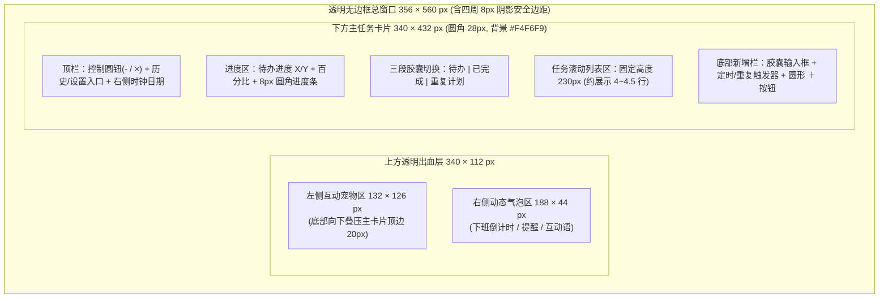
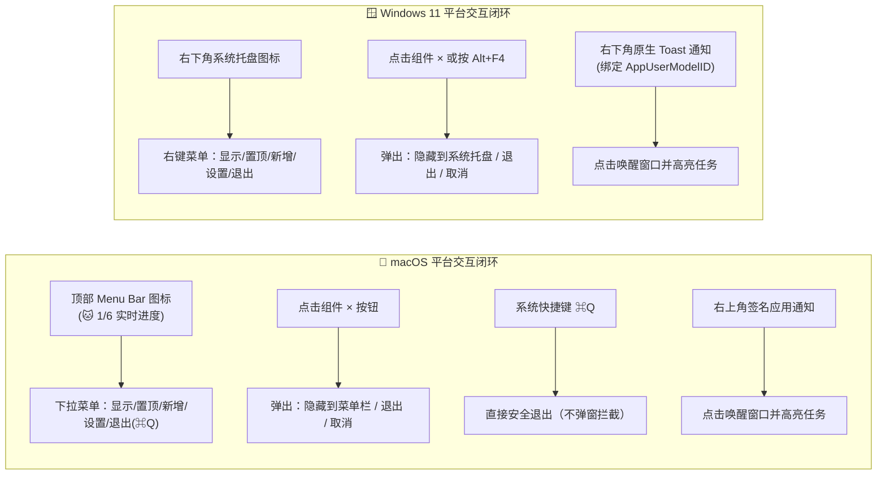

# 桌面任务助手与互动宠物双平台原型设计文档

版本：0.2。设计日期：2026-11-02。对应 [需求文档](requirements.md)、[跨平台技术选型](technical-selection.md) 与 [双平台高保真可交互原型 (HTML)](dual-platform-prototype.html)。

本文档基于用户提供的参考截图与多轮交互打磨，定义 Windows 与 macOS 双平台的界面布局、窗口尺寸、交互流转、宠物动画状态机、可配置宠物资源库及平台差异化行为。具体 DOM 结构、CSS 关键帧动画与状态流转逻辑可直接参考同目录下的 [`dual-platform-prototype.html`](dual-platform-prototype.html)。

---

## 1 参考图还原与首版设计收敛

对比用户提供的参考截图与 [需求文档](requirements.md) 第 1 节确认项，原型设计做出以下还原与调整：

| 区域 | 参考截图表现 | 首版原型设计决策 | 依据 |
| --- | --- | --- | --- |
| 外层顶部 | 社交软件的返回、头像、“每天睡不够”、关注、分享、`1/3` 页码 | **完全剔除**，仅保留桌面透明组件本身 | 需求文档开头说明 |
| 宠物与气泡 | 左上方趴着蓝耳白猫宠物，右侧白色圆角气泡显示 `离下班还有 06:16:28` | **1:1 还原跨卡片叠放构图**；气泡拡張支持“下班倒计时 / 到点提醒 / 互动反馈”三态优先级切换 | F07、F08、F09 |
| 卡片左上控制键 | 蓝灰 `−` 圆钮 + 珊瑚红 `×` 圆钮 | **保留双圆钮视觉**（`−` 直接收起下方任务卡片进入仅桌宠模式，`×` 弹出“隐藏到托盘/退出/取消”选择框），右侧紧邻 3 枚纯图标圆钮 `📅`（历史）、`🐾`（宠物库）、`⚙`（设置），避免文字折行挤压时钟区 | F05、F08、F10、F13 |
| 卡片右上时钟 | 大号 `11:43` + `09月21日 星期一` | **1:1 还原排版**，按本机当前时区实时展示 | F09 |
| 今日进度条 | 左侧 `待办进度 1/6`，右侧 `17%`，下方蓝灰进度条 | **1:1 还原**；空清单时显示 `待办进度 0/0 · 今天还没有任务` 与 `0%` | F06、规则 1.3 |
| 三段式胶囊导航 | `待办` / `已完成` / `打卡` | 将第三项由“打卡”调整为 **`重复计划`**（显示每日重复计划列表与暂停/恢复/结束操作） | 规则 1.1（首版不做打卡）、F02、F03 |
| 任务列表与滚动条 | 白色胶囊行（左圆框、中文字、右 `×`）+ 右侧细滚动条 | **还原视觉**，并在行内补充轻量时间标签（如 `15:00`）、重复标识（`↻ 每日`）及历史迁移标识（`原 11-01`） | F01、F04、规则 4.4 |
| 底部新增栏 | 居中占位符 `新增待办` 圆角输入框 + 右侧圆形蓝色 `+` 按钮 | **输入框改为左对齐**（避免与右侧胶囊按钮拥挤）；回车或点 `+` 快捷创建今日无时间待办，点击输入框右侧 `🕒 定时/重复` 打开完整编辑面板 | 规则 4.1 |

---

## 2 窗口形态与空间尺寸规范

首版采用**单个透明无边框桌面窗口（Frameless Transparent Window）**同时承载宠物、气泡与任务卡片，避免双窗口同步移动带来的错位与多屏撕裂。



### 2.1 尺寸与色彩 Token

| 项目 | 规格数值 | 说明 |
| --- | --- | --- |
| 窗口默认尺寸 | `356 × 560 px`（不可拖拽缩放） | 固定尺寸避免 Electron 透明窗缩放抖动与裁剪 |
| 主卡片背景色 | `#F4F6F9`（外框高光 `#FFFFFF`） | 还原参考图柔和治愈的浅云灰质感 |
| 列表项/输入框背景 | `#FFFFFF`（圆角 `16px` / 胶囊形） | 与 `#F4F6F9` 底色形成柔和层次 |
| 主色调（雾霾蓝） | `#6F9BB6`（悬停 `#5F8CA8`） | 用于选中 Tab、进度条、完成勾选、`+` 按钮与隐藏按钮 |
| 关闭按钮色（珊瑚红） | `#D67A73` | 用于左上角 `×` 按钮 |
| 任务标题字号与限制 | `13px`（最小不低于 `12px`），上限 `60` 字符 | 单行默认截断，悬停或展开编辑时显示完整多行内容 |

### 2.2 鼠标命中与拖拽手势区分（规则 6）

- **宠物区域（点击 + 拖拽双支持）**：
  - `pointerdown` 记录初始屏幕坐标；
  - 若指针移动距离 `< 5px` 且释放时间 `< 250ms`，判定为**点击宠物**，触发 `react` 互动动作与随机气泡；
  - 若指针移动距离 `≥ 5px`，进入**窗口拖动模式**，宠物与卡片整体跟随移动，`pointerup` 时持久化保存窗口坐标，且**不触发**点击事件。
- **卡片顶栏空白区**：支持窗口拖动。
- **按钮、输入框、Tab、任务行、滚动条**：纯交互区域，禁止触发窗口移动。

---

## 3 核心界面与交互流转设计

### 3.1 宠物右侧气泡的三级状态机与场景 GIF 语音提醒

气泡区域宽度限制在 `186 ~ 210 px`，按以下优先级覆盖显示：

1. **P0 到点提醒态（宠物第一人称口语台词 + 专属场景 GIF 动画 + 气泡内闭环按钮）**：
   - **口语化表达与场景 GIF 联动**：到点时不再显示生硬的系统文本，而是由宠物说出贴心的一句话，并同步将宠物切换为对应场景的 GIF/WebP 动画：
     - **喝水场景（`drink_water.gif`）**：宠物端起水杯吨吨喝水/递水杯，气泡显示：`“咕嘟咕嘟～主人今天要喝水啦！快端起杯子陪我喝口温水吧 💧”`
     - **运动拉伸场景（`stretch.gif`）**：宠物举小哑铃/伸懒腰，气泡显示：`“主人久坐好久啦～到了「起身运动」的时间，起来陪我活动一下吧 🙆‍♂️”`
     - **吃药/通用提醒（`remind.gif`）**：宠物捧小药盒或摇铃提醒。
   - **气泡内直接交互（支持免展开菜单一键完成）**：
     - 气泡下方内嵌两个轻量按钮：**`[✓ 我喝完啦 / 完成了]`** 与 **`[展开清单 ▾ / 定位任务 ▾]`**；
     - 点击 **`[✓ 我喝完啦]`**：即使当前下方任务菜单处于隐藏（仅桌宠）状态，也能直接在气泡上一键完成该任务，宠物立刻切换为庆祝跳跃动画并夸奖用户（`“真乖！补充水分超棒的 ✨”`）；
     - 点击 **`[展开清单 ▾]`**：若下方任务菜单已隐藏，则自动向下展开任务菜单，并滚动高亮闪烁对应的任务行。
2. **P1 互动与完成反馈态（短时显示 `2.8 秒` 后自动恢复为 P2）**：
   - 点击宠物：随机展示轻量回应（如 `今天也要加油呀～ 🐾`）
   - 完成单项任务：`完成一项！继续保持 ✨`
   - 今日全部完成（非空列表从 `<100%` 变为 `100%`）：`🎉 太棒啦！今日任务全部达成！`
3. **P2 常态下班倒计时（默认常驻）**：
   - 已配置且未到点：`离下班还有 06:16:28`（以当天固定下班时间减去当前真实时间计算，每秒刷新显示）
   - 已到下班时间：`已下班，辛苦啦 🎉`
   - 尚未配置下班时间：`点击设置下班时间 ⚙`

### 3.1.1 隐藏与展开下方任务菜单（「仅桌宠模式」交互闭环）

日常办公时用户不希望大尺寸任务卡片一直遮挡桌面，因此提供 **「隐藏下方任务菜单（仅留桌宠与气泡）」** 与 **「彻底隐藏到托盘」** 两种不同层级的收敛方式：

| 动作 | 触发方式（支持 3 种入口） | 界面表现与状态变化 |
| --- | --- | --- |
| **如何隐藏下方菜单（进入仅桌宠模式）** | 1. 点击卡片左上角蓝灰 **`−`** 圆钮<br/>2. **双击**宠物身体<br/>3. **右键点击**宠物弹出快捷菜单 → 选择 `🔼 隐藏下方菜单` | 下方白色任务大卡片向上平滑收起并透明隐藏（`max-height: 0`）；桌面上**完整保留宠物全身与右侧气泡**，并在**宠物正下方间隔 `16px` 处（不触碰小脚与尾巴）**展示轻量胶囊 **`● 待办 1/6 \| 展开菜单 ▾`** |
| **如何重新展开下方菜单（恢复完整清单）** | 1. 单击宠物正下方间隔处的微缩胶囊 **`● 待办 1/6 \| 展开菜单 ▾`**<br/>2. **双击**宠物，或右键宠物选择 `🔽 展开下方菜单`<br/>3. 到点提醒时点击气泡上的 **`[展开清单 ▾]`** 按钮 | 下方白色任务卡片从宠物下方平滑展开恢复；微缩胶囊自动隐藏 |

### 3.2 任务列表与三段式导航

- **`待办` Tab**：
  - **排序规则**：有具体时间的任务按时间升序排列在前；无时间的任务排列在后。
  - **视觉标签**：显示时间标签（如 `15:00`）、每日重复标识（`↻ 每日`）、跨天迁移标识（`原 11-01`）。
  - **勾选完成的五步微交互动效（避免瞬时消失）**：
    1. **Q弹打勾 + 粒子迸发（0 ~ 180ms）**：圆框弹性缩放（`scale: 0.75 → 1.28 → 1.0`）并填充雾霾蓝 `#6F9BB6`，内部白色对勾 `✓` 沿路径动态绘制，同时向四周迸发 8 颗小星星/爱心彩色粒子。
    2. **动态贯穿删除线 + 猫爪完成章（90 ~ 380ms）**：任务文字从左向右平滑划过删除线（`width: 0% → 100%`），整行卡片泛起浅青色高光（`#EEF7FC`），右侧弹出 `🐾 完成!` 印章。
    3. **星光能量飞向宠物（240 ~ 680ms）**：一颗闪光星粒 `✨` 从勾选框沿弧线飞向左上方的互动宠物，衔接宠物的欢呼跳跃与进度条增长。
    4. **丝滑收起与列表上移（620 ~ 880ms）**：停留约 `0.6s` 让用户充分看清打勾与划掉效果后，该行向右轻滑并平滑折叠高度（`max-height` 过渡），下方任务自然上移，同时「已完成」Tab 数字轻微弹跳。
    5. **防手滑中断**：在行完全折叠前的 `0 ~ 620ms` 窗口期内，再次点击勾选框可立即中断动画并取消勾选。
  - **编辑与删除语义区分（F01 / F03 / 规则 4.3）**：
    - 每条待办行右侧提供轻量 **`✎` 编辑按钮**（亦支持双击任务行）：若为一次性任务，打开编辑面板修改名称、执行日期、时间与提醒开关；若为每日重复计划实例，直接打开其所属重复计划进行编辑；
    - 一次性任务点击右侧 `×`：平滑折叠移除该任务并重算进度；
    - 每日重复计划生成的今日实例点击右侧 `×`：平滑折叠移除今天本次执行安排（标记 `removedOccurrence = true`，不影响后续日期的重复计划生成）。
- **`已完成` Tab**：
  - 按完成时间倒序排列，展示完成时刻（如 `10:05 完成`）。
  - 点击左侧实心勾号或右侧“撤销”可将任务恢复至“待办”，实时回退进度百分比（已提醒过的实例撤销后不重复提醒）。
- **`重复计划` Tab（F02 / F03）**：
  - 展示所有生效中与已暂停的每日重复计划卡片（含计划名称、起止日期标签如 `10-20 起` 或 `10-15 ~ 11-01`、每日多个时间槽如 `10:00、15:00`、当前状态）。
  - 提供 **`编辑`**（回填计划名称、可增删的时间槽、起止日期与提醒开关）、**`暂停 / 恢复`**（暂停期间取消未到点调度，恢复后不补发旧提醒）与 **`结束`**（清理今日及后续未完成实例，保留历史完成记录）独立按钮。

### 3.3 新增/编辑任务与重复计划面板（Modal 抽屉）

点击底部输入框内右侧 `🕒 定时/重复`、在输入框为空时点击 `+` 按钮，或点击已有任务/计划的 `✎ 编辑` 按钮，在卡片内部弹出圆角面板：

- **顶部类型切换**：`一次性任务` | `每日重复计划`
- **一次性任务字段**：任务名称、执行日期（默认当前查看日期或今天，支持选择明天或任意未来日期，保存后按 `scheduledDate` 归入对应日期清单）、提醒时间（可选）、到点提醒开关。
- **每日重复计划字段**：计划名称、**每日时间槽列表**（支持 `+ 添加时间` 与点击时间胶囊右侧 `×` 移除任意默认或新增时间槽，同一计划内自动排序去重）、开始日期、可选结束日期（闭区间包含结束日期当天，次日起不再生成新实例）、提醒开关。

### 3.4 日期切换、历史查看与“移到今天”（F05 / A04 / A05）

- 点击顶栏 `📅` 按钮可展开日期切换横幅，支持一键切换 **`11-01 昨天` / `11-02 今天` / `11-03 明天`** 或通过日期选择器查看任意日期的清单。
- 处于非今日日期视图时，进度条上方常驻显示当前查看日期与 **`[返回今天]`** 按钮，且顶部 Menu Bar 与宠物脚下胶囊始终保持展示**今天**的实时完成比。
- 历史日期未完成的任务不会自动清空或自动完成；每条历史未完成任务右侧展示 **`[移到今天]`** 按钮。
- 点击 `[移到今天]` 后，该任务执行日期更新为今天，并在今日列表中附带 `原 11-01` 标签；同一天重复操作不会产生副本。

### 3.5 关闭确认弹窗与异常提示条（F10 / A08 / A09 / A14）

- **关闭确认弹窗**：每次点击卡片左上角珊瑚红 `×` 按钮，弹出三选一面板：
  1. **📥 隐藏到托盘 / 菜单栏（推荐）**：隐藏主窗口，暂停宠物待机动画，后台提醒调度继续运行；
  2. **🚪 退出软件**：完成数据保存后终止进程，停止后续所有提醒；
  3. **取消**：关闭弹窗，保持窗口当前状态。
- **非阻塞式顶部状态条**（位于卡片内顶栏上方，按需出现）：
  - **休眠恢复汇总条（A09）**：`⏰ 休眠期间有 N 项任务已到点 [知道了]`（避免唤醒时连续弹出多条系统通知）。
  - **通知权限不可用条（A14）**：`⚠️ 系统通知未开启，仅显示气泡提醒 [去开启]`（不影响任务正常勾选与保存）。

---

## 4 Windows 与 macOS 双平台差异化设计



| 维度 | Windows (Windows 10 / 11 x64) | macOS (Apple Silicon / Intel) |
| --- | --- | --- |
| **系统常驻入口 (F12)** | 右下角系统托盘（System Tray），支持左键单击直接切换显示/隐藏，右键展开菜单 | 顶部状态栏（Menu Bar），图标旁可直接显示今日完成比 `1/6`，点击展开菜单 |
| **任务栏 / Dock 策略** | 窗口隐藏时不在底部任务栏占据大图标（`skipTaskbar: true`），保持桌面插件轻量感 | 常驻 Menu Bar，隐藏窗口时可通过 `app.dock.hide()` 避免 Dock 图标残留，显示时恢复 |
| **关闭与退出快捷键** | 点击组件 `×` 或对窗口按 `Alt+F4` 均弹出“隐藏/退出/取消”选择框；托盘菜单点“退出”直接退出 | 点击组件 `×` 弹出选择框；用户按 **`⌘Q`** 或菜单栏点“退出”时通过 `before-quit` 标志直接退出，不反复拦截 |
| **系统通知样式与定位** | 右下角 Windows Toast 通知，安装包内配置 `AppUserModelID` 与开始菜单快捷方式 | 右上角 macOS Notification Center 横幅，使用签名包保证通知正常投递与点击回调 |
| **多屏与缩放适配** | 监听 `display-removed` 与 DPI 缩放（100% ~ 200%），若保存坐标落在屏幕外则自动拉回主屏安全区 | 适配 Retina 2x 渲染与外接显示器热插拔，确保窗口标题区始终处于可见屏幕工作区内 |

---

## 5 可配置宠物资源库（Pet Resource Library）与动画规范

为支持“无需改代码即可切换宠物、微调趴卧位置与导入新素材包”，宠物系统采用**数据驱动的资源包（Pet Pack）架构**。

### 5.1 资源库目录结构（双目录合并扫描）

应用启动或打开「🐾 宠物资源库」面板时，主进程自动合并扫描以下两个目录：

1. **内置资源库（只读）**：`<appResources>/pets/<pet-id>/manifest.json`（随安装包分发，如默认内置 `hachiware`）
2. **用户自定义资源库（可读写）**：`<userData>/pets/<pet-id>/manifest.json`（用户在界面中导入 `.zip`/文件夹，或点击「📂 打开资源目录」手动放入的宠物包）

```text
<userData>/pets/
  ├── hachiware/
  │   ├── manifest.json       # 宠物元数据、动作状态帧定义、锚点与专属台词
  │   ├── preview.png         # 资源库列表缩略图 (128×128)
  │   ├── idle.webp           # 待机精灵图或动图
  │   ├── react.webp          # 点击回应动作
  │   ├── celebrate.webp      # 单项任务完成庆祝动作
  │   ├── all_done.webp       # 今日全部完成庆祝动作
  │   └── remind.webp         # 到点提醒动作
  └── shiba-custom/
      └── manifest.json
```

### 5.2 `manifest.json` 配置文件规范

每个宠物包通过 `manifest.json` 声明渲染尺寸、叠放偏移、5 个标准动作状态及专属气泡台词：

```json
{
  "id": "hachiware",
  "name": "小八猫 (Hachiware)",
  "version": "1.0.0",
  "canvasSize": [256, 256],
  "displaySize": [132, 126],
  "scale": 1.0,
  "anchorOffset": { "x": 12, "y": -20 },
  "states": {
    "idle":      { "src": "idle.webp",      "frames": 8,  "cols": 4, "fps": 6,  "loop": true },
    "react":     { "src": "react.webp",     "frames": 10, "cols": 5, "fps": 12, "loop": false },
    "celebrate": { "src": "celebrate.webp", "frames": 12, "cols": 4, "fps": 12, "loop": false },
    "all_done":  { "src": "all_done.webp",  "frames": 16, "cols": 4, "fps": 12, "loop": false },
    "remind":    { "src": "remind.webp",    "frames": 8,  "cols": 4, "fps": 10, "loop": true }
  },
  "quotes": {
    "react": [
      "今天也要加油呀～ 🐾",
      "摸摸头，万事不愁 ✨",
      "喝口水休息一下吧 🍵"
    ],
    "celebrate": "完成一项！继续保持 ✨",
    "allDone": "🎉 太棒啦！今日任务全部达成！"
  }
}
```

### 5.3 界面中的「🐾 宠物资源库与配置中心」面板

在组件顶栏胶囊（`📅 历史 | 🐾 宠物 | ⚙`）中点击 **`🐾 宠物`**，弹出配置面板，包含两个子页签：

1. **角色资源包页签**：
   - 展示所有内置与用户导入的宠物包卡片（缩略图、名称、来源路径、帧率标签），支持**一键切换立即生效**；
   - 底部提供 **「＋ 导入本地资源包 (.zip / 文件夹)」** 与 **「📂 打开资源目录」** 按钮（调用系统 Finder / Explorer 打开 `<userData>/pets/`）。
2. **坐标/帧率与 Manifest 页签**：
   - **缩放比例滑块（`80% ~ 120%`）**：实时调整不同画风素材的显示大小；
   - **趴卧偏移 Y 滑块（`-32px ~ -4px`）**：微调宠物下沿与白色卡片顶边的叠压深度，适配不同角色爪子/身体位置；
   - **待机帧率选择（`6 / 8 / 12 FPS`）**：兼顾流畅度与后台常驻功耗；
   - **容错降级机制**：若用户自定义包缺少某个动作图（如未提供 `all_done.webp`），自动回退使用 `celebrate` 或 `idle`，并在界面给出非阻塞提示，绝不导致应用崩溃。

### 5.4 动作状态机与节能规范

| 状态标识 | 触发条件 | 循环规则 | 默认帧率建议 | 优先级 |
| --- | --- | --- | --- | --- |
| `idle` | 默认待机状态 | 无限循环（`loop: true`） | `6 ~ 8 fps`（低频呼吸/眨眼/摇尾，降低常驻 CPU） | P3（最低） |
| `react` | 用户点击宠物（非拖拽） | 单次播放后回到 `idle` | `12 fps`（约 `0.8 ~ 1.2s`） | P2 |
| `celebrate` | 完成单个任务实例 | 单次播放后回到 `idle` | `12 fps`（约 `1.0 ~ 1.5s`） | P2 |
| `all_done` | 当日非空清单达成 100% | 单次播放后回到 `idle` | `12 fps`（约 `1.8 ~ 2.5s`） | P1 |
| `remind` | 任务到点提醒期间 | 循环播放 3 次或持续至点击气泡 | `10 fps` | P0（最高，不被普通点击打断） |

- **后台节能策略**：当窗口处于隐藏状态（Hidden to Tray/Menu Bar）或系统锁屏/休眠时，立即暂停渲染层精灵图动画定时器，待窗口重新可见时恢复 `idle`。

---

## 6 原型阶段待明确项的建议收敛结论

针对 [需求文档](requirements.md) 第 9 节列出的“原型阶段需明确项”，本设计给出以下默认基准，供确认：

1. **界面布局与尺寸**：固定为 **`356 × 560 px`** 单透明窗口（上方 `112px` 宠物与气泡层 + 下方 `432px` 主卡片），列表区固定高度滚动，最多同时可见 4.5 条任务。
2. **窗口默认是否置顶**：默认 **开启置顶（Always on Top = true）**，符合桌面贴纸/宠物组件直觉，并在托盘/菜单栏与设置面板提供一键切换开关。
3. **正式支持的系统版本与芯片架构**：首轮 M0/M5 聚焦 **Windows 10/11 (x64)** 与 **macOS 13+ (Apple Silicon arm64)**；Intel Mac 通过 electron-builder 额外构建 `x64` 或 `universal` 包。
4. **应用退出后的旧通知点击行为**：应用处于隐藏状态时，点击系统通知立即唤醒窗口并定位任务；应用已明确退出后，停止后台进程，不驻留守护进程监听旧通知。
5. **未运行日期的历史补齐策略**：启动时仅生成并补齐**今天（当日）**的有效任务实例，历史日历只展示实际运行并生成过的日期记录，不逆向伪造未开机日期的逾期记录。
