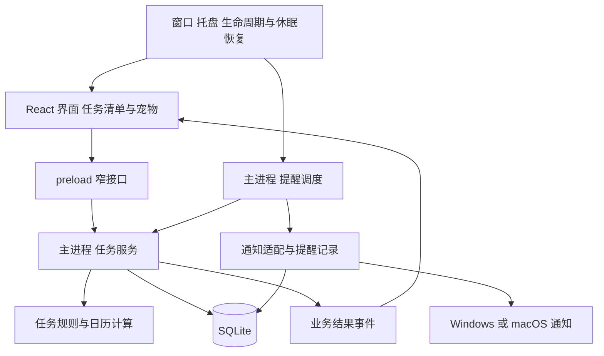

# Windows 和 macOS 跨平台技术选型

评估日期：2026-11-02。范围对应 [需求文档](requirements.md) 的首版 P0。

建议首版使用 **Electron + React + TypeScript + SQLite**，用 electron-vite 开发和构建，用 electron-builder 生成双平台安装包。先用一个小型原型验证透明窗口、宠物交互、后台提醒及安装后的系统通知，再固定技术栈。

这一建议以“主要开发者熟悉 Web 与 TypeScript，希望尽快完成双平台首版”为估算前提，开发者的 Rust 或 Dart 熟练度尚未确认。如果最重要的约束变成安装包大小或常驻资源预算，优先重新评估 Tauri。当前已有浏览器原型和规划文档，Electron 处于 M0 技术验证阶段，以下平台表现均不是已经完成双平台实测的结果。

优化原型进入架构阶段后，Electron 作为当前设计基线；模块、接口和业务细节以 [应用架构](architecture.md) 为准。本机 macOS M0 的实际结果和仍未验证的能力见 [M0 验证记录](m0-verification.md)，不替代 Windows 与正式分发验收。

## 1 选择依据

这个产品的主要难点是桌面生命周期和任务时间规则：隐藏窗口之后仍要提醒，跨天与休眠后要恢复正确，宠物所在的透明区域要能点击和拖动，安装后的系统通知要能回到任务。普通网页原型只能验证部分界面体验。

| 维度 | Electron | Tauri | Flutter |
| --- | --- | --- | --- |
| 主要语言 | TypeScript，少量必要的原生适配 | 前端 TypeScript，宿主与扩展涉及 Rust | Dart，必要时增加平台代码 |
| 界面渲染 | 随应用分发 Chromium，双平台渲染基础较一致 | Windows 使用 WebView2，macOS 使用 WKWebView，需要验证两种引擎差异 | Flutter 自有界面体系，桌面平台与插件均受官方支持 |
| 桌面能力 | 窗口、托盘、通知、休眠恢复可围绕主进程统一组织 | 核心 API 与插件可覆盖，关键行为需在所选版本和安装包上验证 | 支持桌面开发，透明窗、托盘等集成需逐项核对插件或补平台代码 |
| 包体与常驻成本 | 需要承担内置运行时成本，实际内存、CPU 和包体需测量 | 有小包体优势；使用系统 WebView 不代表实际运行成本可以不测 | 本项目不预判资源优劣，以原型实测为准 |
| 对现有 Web 经验的利用 | 高，界面与大部分业务可使用 TypeScript | 界面可复用，宿主部分有另一套工具链 | 需要使用 Dart 和 Flutter 的界面体系 |
| 本项目判断 | 默认推荐，优先控制交付与维护成本 | 资源预算更严格，或开发者熟悉 Rust 时重点考虑 | 已有成熟 Flutter 经验时再考虑作为首选 |

框架事实分别参考 [Electron 进程模型](https://www.electronjs.org/docs/latest/tutorial/process-model)、[Tauri WebView 说明](https://tauri.app/reference/webview-versions/)、[Tauri 包体优化](https://tauri.app/concept/size/) 和 [Flutter 桌面支持](https://docs.flutter.dev/platform-integration/desktop)。表格中的项目适合度是针对本需求的判断，不是通用性能排名。

### 1.1 为什么默认选 Electron

- 任务界面、时间规则与宠物动画可以围绕 TypeScript 组织，减少首版涉及的语言与工具链。
- 后台调度和持久化放在主进程，窗口只是界面，不会因用户隐藏窗口而失去业务入口。
- 现阶段是两个桌面平台，任务清单与轻量精灵图动画不足以单独构成引入另一套界面体系的理由。
- 代价是包体和常驻成本，需要在原型阶段测量，不能承诺“轻量”后再补性能验证。

Electron 并非自动解决所有透明窗问题。官方列出的限制包括透明区域不会自动穿透点击，以及透明窗的可调整大小行为有限制。因此首版建议固定窗口尺寸、收紧透明边缘，避免把复杂逐像素穿透当成默认能力。[Electron 透明窗口说明](https://www.electronjs.org/docs/latest/tutorial/custom-window-styles)

### 1.2 Tauri 的适用条件

满足以下条件时，可以在正式实现前将默认路线改为 Tauri：

- 开发者能够维护 Rust 宿主逻辑，或愿意承担相应学习与排错成本。
- 同功能原型显示其资源表现更符合明确的目标机器预算。
- Windows 和 macOS 的透明窗、托盘、通知点击和恢复行为均通过验证。

不要用旧版本文章代替当前验证。当前 Tauri 配置文档将 `macOSPrivateApi` 标为在 2.12.1 及以后不再起开关作用；具体透明窗实现与分发约束应以锁定版本为准。本计划以直接分发安装包为前提，不把应用商店审核兼容性作为已经成立的结论。[Tauri 当前配置说明](https://tauri.app/reference/config/#macosprivateapi)

Tauri 官方还注明 Windows 通知需要在安装后的应用中验证，开发状态不能替代安装包验收。[Tauri 通知插件](https://tauri.app/plugin/notification/)

## 2 建议技术栈

| 层次 | 建议 | 作用与边界 |
| --- | --- | --- |
| 桌面宿主 | Electron 的受支持稳定版本 | 窗口、生命周期、后台入口、通知与调度 |
| 界面 | React + TypeScript | 清单、编辑面板、设置、宠物与气泡 |
| 开发与构建 | electron-vite | 统一组织主进程、preload 和渲染进程构建 |
| 本地数据库 | SQLite，优先评估 better-sqlite3 | 保存计划、实例、提醒处理记录和设置 |
| 精灵图 | PNG 或 WebP + 动画描述 JSON | 帧序列、锚点、播放速度与状态切换 |
| 动画实现 | 简单 CSS 帧动画优先，必要时局部 Canvas | 不为一只宠物引入完整游戏引擎 |
| 安装包 | electron-builder 的稳定发布版本 | Windows 安装程序、macOS 应用与 DMG |
| 界面状态 | 先用 React 自带能力 | 本地编辑状态留在界面，持久业务数据由主进程管理 |

electron-vite 支持三个进程部分的构建与开发刷新；electron-builder 提供平台打包和签名相关集成。实施时锁定版本和锁文件，避免误将预发布文档中的配置当成稳定能力。[electron-vite 文档](https://electron-vite.org/guide/)、[electron-builder 稳定版文档](https://www.electron.build/v26/)

better-sqlite3 是候选数据库驱动，不是已验证的二进制依赖组合。它涉及原生模块，需要提前验证 Electron ABI、目标系统和芯片架构的构建与打包；不能把宿主 Node.js 中运行成功当作 Electron 安装包可用。[驱动项目](https://github.com/WiseLibs/better-sqlite3)、[Electron 原生模块说明](https://www.electronjs.org/docs/latest/tutorial/using-native-node-modules)

## 3 进程与模块边界

- 渲染进程负责显示、输入和动画，不直接访问数据库，不持有唯一的提醒定时器。
- preload 只暴露具体业务命令和事件，例如新增任务、完成实例、显示窗口，不暴露任意文件、SQL 或通用 IPC 调用入口。
- 主进程负责校验命令、持久化和调度，只有成功提交业务操作后才通知界面更新。
- 任务规则集中在少量可独立测试的模块中。时间与时区作为显式输入，避免业务逻辑到处读取系统时钟。
- 宠物根据任务完成和提醒等结果播放动作，不反向决定任务状态；动画失败不影响保存与提醒。
- 首版使用一个宿主进程和一个主要窗口，保持普通模块边界，不提前增加微服务、插件平台或多进程任务队列。

主进程与渲染进程的职责依据 [Electron 进程模型](https://www.electronjs.org/docs/latest/tutorial/process-model)。页面默认只加载打包的本地内容，启用隔离与沙箱，通过有限接口访问宿主能力。[Electron 安全建议](https://www.electronjs.org/docs/latest/tutorial/security)

## 4 数据设计

| 数据对象 | 需要保存的核心信息 | 关键约束 |
| --- | --- | --- |
| repeat_plans | 当前每日重复规则、状态与版本 | 一次性任务直接保存为实例，不重复建立模板 |
| plan_slots | 稳定时间槽、当前时间与有效标记 | 改时间保留槽 ID，移除保留历史引用 |
| task_occurrences | 实例 ID、来源计划与版本、时间槽、原计划日期时间、当前执行日期时间、状态、完成时间 | 按来源日期与槽去重；移动或取消后仍保留身份 |
| reminder_dispatches | 实例、提醒版本、处理状态、提交时间与错误 | 同一逻辑提醒只有一条有效处理记录 |
| calendar_days | 实际激活日期、时区与时间 | 区分当天无安排与未产生记录 |
| app_settings | 下班时间、提醒偏好、窗口位置和显示设置 | 与任务数据一起受版本迁移管理 |

此表已按架构设计收敛，完整字段与事务见 [数据模型](data-model.md)。历史依靠实例快照保存，首版不额外维护完整计划版本历史表。

实例状态建议为待完成、已完成、已取消。是否逾期从时间与状态推导，不维护第二套容易失配的“逾期状态”。

启动与跨天时显式补齐当天，历史只查询已有记录，未来日期返回计划预览。生成操作有数据库唯一约束，重启、重复点击和调度重入不产生副本。已经取消的实例保留必要标记，防止重新生成时复活。

计划修改时取消未到点的旧安排，再按新版本补齐后续安排；完成、已到点和用户手动迁移的实例保留独立身份。具体生效范围使用事务处理，避免界面只改了一半。

日期与时间的存储区分两种语义：重复规则保存本地日历日期与墙上时间；完成、修改、通知提交等事件保存 UTC 时间戳。历史同时保留当时解析的时区和原计划时间，不能只保存“离现在还有多少秒”。夏令时与系统时区变化需要专门用例。

数据库保存在应用用户数据目录，不放安装目录。正常操作即保存，迁移前备份，迁移失败时保留旧数据并显示可理解的失败状态。批量历史查询使用分页；首版先保持小事务，只有实测存在阻塞时才考虑将数据库工作移出主进程。

## 5 提醒调度

建议采用“到期时间计算 + 最近一次唤醒 + 低频校验”的主进程调度方式：

1. 启动时生成当天清单，恢复尚待处理的提醒，并检查当日遗漏。
2. 计算最近待提醒实例，设置一次定时唤醒；计划变化、完成或删除时重新安排。
3. 唤醒后重新读取当前时间和实例状态，再决定提交提醒，不直接相信旧的倒计时结果。
4. 记录提交或失败结果，通知界面显示气泡；有多项同时到点时汇总处理。
5. 在跨天、休眠恢复和低频校验时重新核对时间；系统时钟回拨不重复生成实例。

Electron 的后台网页会节流动画和定时器，因此提醒不得依赖渲染进程的 `setInterval`。主进程仍然受电脑休眠、进程暂停和系统调度影响，恢复时必须重新计算。[后台节流说明](https://www.electronjs.org/docs/latest/api/web-contents#contentsbackgroundthrottling)、[休眠与恢复事件](https://www.electronjs.org/docs/latest/api/power-monitor)

本地数据库与操作系统通知不是同一个事务，不能承诺进程崩溃边界上的严格恰好一次。方案应使用稳定通知标识、持久化处理记录和有界恢复：普通重启去重，异常中断后的中间态在恢复时汇总，不无限重试或连续补弹。测试需要覆盖“记录已写但通知未提交”和“通知已提交但结果未写回”。

提醒清单、完成状态、倒计时全部以当前真实时间计算。下班倒计时由当天固定下班时间减当前时间得到，不通过每秒减一维护。

## 6 宠物与窗口实现

首版采用一个透明无边框窗口，同时容纳宠物、气泡和任务卡片。这样窗口移动、隐藏、缩放和恢复由同一个生命周期管理。需要给动作和气泡预留边界，避免动画被窗口裁剪。

卡片标题区域可作为原生拖动区；输入框、按钮和任务行保持交互区。宠物既需要点击又需要拖动，应使用明确的指针阈值区分两种手势，不直接把整个宠物都设为无法接收点击的拖动区域。

透明背景不会自动实现鼠标穿透。若原型证明透明空白明显挡住其他应用，可评估命中区域切换；`setIgnoreMouseEvents` 控制的是整个窗口，不能直接当成逐像素穿透。首版优先通过紧凑边界减少遮挡，并验证从透明区移回宠物和输入区域后仍能正常点击。[窗口鼠标事件 API](https://www.electronjs.org/docs/latest/api/base-window#winsetignoremouseeventsignore-options)

动画描述统一定义资源文件、帧尺寸、帧数、锚点、播放速度与是否循环。建议动作集合为 `idle`、`react`、`celebrate`、`remind`，全部完成使用独立动作或庆祝变体。播放速度按素材适配，隐藏时暂停，避免为待机动作维持高频全局刷新。

首版不要求 AI 对话、养成数值或游戏物理系统。宠物行为通过一个小型状态控制器处理，避免点击连续打断重要提醒或积压大量庆祝动作。

## 7 双平台验证与分发

| 项目 | Windows | macOS |
| --- | --- | --- |
| 后台入口 | 系统托盘与菜单 | 菜单栏图标与菜单，核对 Dock 行为 |
| 窗口关闭 | 自定义关闭选择，覆盖 Alt+F4 的窗口关闭路径 | 组件关闭走选择框；系统退出保留退出语义 |
| 通知 | 核对安装后的应用身份、开始菜单入口与点击定位 | 用实际签名的应用验证通知与点击定位 |
| 显示 | 多屏、不同 DPI、任务栏位置变化 | Retina、外接屏、空间切换与缩放 |
| 首轮测试目标 | Windows 11 x64 | Apple Silicon 设备上的 macOS |
| 后续兼容边界 | Windows 10 与 Windows ARM 需明确真实需求 | 最低系统版本、Intel 包与 Universal 包需明确需求 |
| 分发形式 | 优先评估 NSIS 安装程序 | 优先评估应用包与 DMG |

以上系统和架构是候选测试范围，不是框架能力清单或已承诺的最低系统版本。M0 锁定依赖版本后记录精确兼容范围；开发机上运行成功不能替代另一平台的安装后测试。

Electron 的 Windows 通知有应用身份与快捷方式配置要求；当前 macOS 通知 API 文档明确要求代码签名。因此通知验证必须进入 M0，不能在发布前才第一次测试。[通知平台差异](https://www.electronjs.org/docs/latest/tutorial/notifications#platform-considerations)、[通知 API](https://www.electronjs.org/docs/latest/api/notification)

对外提供顺畅安装的 macOS 版本时，将 Developer ID 签名与公证列为发布交付项；Windows 评估代码签名与安装提示，签名不等于保证所有系统信誉提示立即消失。凭据和证书准备是外部依赖，计划中单独跟踪。[Electron 签名与公证](https://www.electronjs.org/docs/latest/tutorial/code-signing)

## 8 技术路线确定的门槛

M0 必须提交可以复核的结果：

- 两个平台的可安装原型，透明宠物与卡片能点击、拖动和隐藏后恢复。
- 安装后通知可提交，应用运行时点击可定位；权限拒绝或通知失败有明确表现。
- 隐藏后提醒仍运行，退出后停止；休眠恢复后的遗漏事项可以汇总。
- SQLite 在目标安装包中可读写，重启后数据保留；原生依赖的构建过程可复现。
- 记录冷启动时间、安装包大小、进程合计内存、可见与隐藏时的 CPU，并记录机器、系统和架构。

资源预算在目标机器上确认，不使用框架宣传中的空项目数字当本产品指标。若 Electron 超出明确预算，再制作同功能 Tauri 样本比较；不同时维护两套正式实现。

完整开发步骤与估算见 [开发计划](development-plan.md)。
